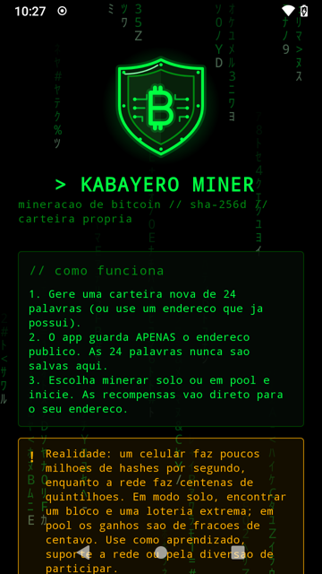
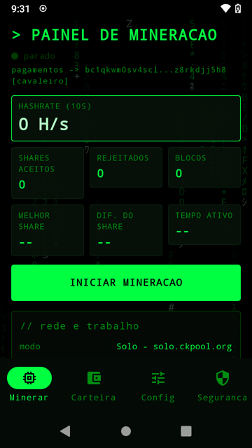
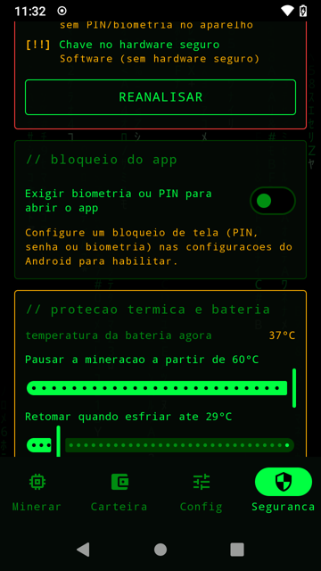
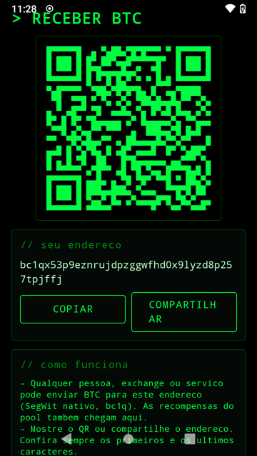

# Kabayero Miner

Minerador de Bitcoin para Android com carteira própria de 24 palavras, envio e recebimento de BTC, interface dark estilo Matrix e um princípio inegociável: **as 24 palavras nunca ficam no aparelho**.

Roda em qualquer celular Android 6.0 ou superior, sem cadastro e sem servidores do app. Código aberto (MIT). Novidades e suporte no Instagram [@cavaleiro.ai](https://www.instagram.com/cavaleiro.ai/).

<p align="center">
  
  
  
  
</p>

> **Leia antes de usar.** Um celular produz centenas de milhares de hashes por segundo; a rede Bitcoin produz centenas de quintilhões. Em modo **solo**, encontrar um bloco é uma loteria com chance ínfima (o app calcula e mostra o tempo esperado). Em **pool**, os ganhos são frações de centavo por dia. O app existe para aprendizado, para apoiar a rede e pela diversão de participar, não como fonte de renda.

## Comece por aqui

| Você quer... | Leia |
| --- | --- |
| Instalar e usar sem saber nada de Bitcoin | [Tutorial para iniciantes](docs/02-tutorial-iniciante.md) |
| Entender o que o app faz em cada etapa | [Como funciona, passo a passo](docs/01-como-funciona.md) |
| Ler ou modificar o código | [Arquitetura e documentação técnica](docs/03-arquitetura.md) |
| Saber o que fica (e o que nunca fica) no aparelho | [Modelo de segurança e ameaças](docs/04-seguranca.md) |
| Tirar uma dúvida rápida | [Perguntas frequentes](docs/05-faq.md) |
| Perguntar à documentação no seu PC, offline | [RAG local](tools/rag/README.md) |

**Download:** a versão mais recente está em [Releases](https://github.com/cavaleiro-ai/kabayero-miner/releases) (`KabayeroMiner-x.y.z-release.apk` + `SHA256SUMS.txt`). A Google Play não permite apps que mineram no aparelho, por isso a instalação é direta pelo APK.

## O que o app faz

| Área | Funcionalidade |
| --- | --- |
| Carteira | Gera 24 palavras BIP39 (256 bits via `SecureRandom`), deriva o endereço SegWit nativo `bc1q...` (BIP84, `m/84'/0'/0'/0/0`) e a `zpub` da conta. Também aceita um endereço existente (bc1q, bc1p, 3..., 1...). |
| Segredo | As 24 palavras aparecem **uma única vez**, em tela com captura bloqueada, com confirmação de 4 palavras aleatórias. **Nunca são gravadas**, cifradas, copiadas ou enviadas. Sair do app com as palavras na tela descarta a carteira. |
| Persistência | Apenas dados públicos (endereço, zpub, preferências), cifrados com AES-256-GCM por chave do Android Keystore (StrongBox quando disponível). Backup em nuvem e transferência desativados. |
| Mineração | Motor SHA-256d em Kotlin puro com midstate, cliente Stratum V1 (TCP/TLS, IPv4 primeiro), serviço em primeiro plano com wake lock. |
| Potência | Barra única de 0 a 100% da capacidade do celular (painel e Config). O app converte em threads + intensidade (ex.: 30% em 4 núcleos = 2 threads a 60%) e aplica na hora, sem reconectar. 0% mantém a conexão sem calcular. |
| Proteção térmica | Na aba Segurança o usuário escolhe a temperatura que pausa a mineração (35 a 60 °C) e a temperatura de retorno (histerese), vê a temperatura atual e as mudanças valem na hora. Também: minerar só com carregador e bateria mínima. |
| Solo | `solo.ckpool.org:3333` ou `public-pool.io:21496` (recompensa inteira do bloco para o seu endereço). |
| Pool | `mine.ocean.xyz:3334` (sem cadastro, pagamento direto na coinbase) ou qualquer servidor Stratum V1, com TLS opcional. |
| Receber | QR code, endereço, copiar e compartilhar. |
| Enviar | Para qualquer endereço (bc1q, bc1p, 3..., 1...), com taxas do mempool.space ou sat/vB manual, "enviar tudo", troco de volta ao próprio endereço, RBF e locktime anti fee-sniping. As 24 palavras são digitadas **no momento do envio**; a chave é derivada e usada só em memória, a transação (P2WPKH, BIP143) é assinada com ECDSA/RFC 6979, transmitida, e tudo é apagado. |
| Segurança extra | Bloqueio por biometria/PIN, relatório de integridade (root, depurador, emulador, ADB, bloqueio de tela, nível do Keystore), HTTP em texto puro bloqueado, permissões mínimas, zona de perigo para apagar tudo. |
| Honestidade | O painel mostra hashrate real, dificuldade da rede e o **tempo esperado até um bloco** com o seu aparelho. |

## Modelo de segurança em cinco linhas

1. **Nada secreto é gravado.** Só endereço, zpub e preferências, cifrados por chave do Keystore.
2. **Criação, verificação e envio** usam as palavras apenas em memória, em telas com captura bloqueada, e as apagam ao terminar ou ao sair do app.
3. **Sem servidores do app.** O celular fala com o pool (Stratum) e, se você pedir, com o mempool.space (saldo, taxas, transmissão).
4. **Criptografia própria, verificada** por vetores oficiais: BIP39, BIP32, BIP84, RIPEMD-160, SHA-256d, Bech32/Bech32m, ECDSA/RFC 6979 e BIP143.
5. **Alternativa sempre disponível:** importe as palavras em Sparrow, BlueWallet ou Electrum (BIP84); o primeiro endereço é o mesmo do app.

Detalhes e tabela de ameaças em [docs/04-seguranca.md](docs/04-seguranca.md).

## Compilar

Pré-requisitos: JDK 17+ e Android SDK (platform 35, build-tools 35). Com Android Studio basta abrir a pasta (ou clonar por "Get from VCS"). Pela linha de comando:

```bash
./gradlew testDebugUnitTest      # 55 testes com vetores oficiais
./gradlew assembleDebug          # app/build/outputs/apk/debug/app-debug.apk
./gradlew assembleRelease        # minificado; assine com keystore.properties (fora do git)
```

`keystore.properties` (não versionado):

```
storeFile=../minha-chave.jks
storePassword=...
keyAlias=...
keyPassword=...
```

Testes contra pools reais (job atual vs. ponta da cadeia; motor completo com shares aceitos):

```bash
./gradlew testDebugUnitTest --tests "*LiveTest*" -Dstratum.live=true
```

O workflow `.github/workflows/android.yml` roda os testes e publica os APKs como artefato a cada push.

## Estrutura

```
app/src/main/kotlin/br/com/cavaleiros/mineradores/
  wallet/     Hash, Secp256k1, Ecdsa, Base58/Bech32, Bip39, Bip32, WalletFactory, Transaction
  mining/     Sha256Miner (midstate), StratumJob, StratumClient (TCP/TLS), MiningEngine
  security/   KeystoreCrypto (AES-GCM no Keystore), SecureStore, DeviceIntegrity
  data/       Models (potência, temperaturas, pools), AppRepository, BalanceApi, ChainApi
  service/    MiningService (foreground, wake lock, bateria/temperatura)
  ui/         Tema Matrix, componentes (PowerBar, ShieldLogo...), ViewModel, telas e navegação
app/src/test/ vetores oficiais e testes do núcleo
docs/         documentação completa (como funciona, tutorial, arquitetura, segurança, FAQ)
tools/rag/    RAG local para perguntar à documentação offline
```

## Validação (2026-11-04)

| Teste | Resultado |
| --- | --- |
| 55 testes unitários (BIP39/BIP32/BIP84, RIPEMD-160, gênesis, bloco 125552, alvo/dificuldade, montagem de job, potência->threads, ECDSA/RFC 6979, BIP143, scripts de endereço, planejador de envio) | todos passam |
| Job ao vivo de solo.ckpool.org, public-pool.io e mine.ocean.xyz | prevhash do job = ponta da cadeia no mempool.space, altura = ponta + 1 |
| Motor completo no PC (JVM, 12 threads, ~17 MH/s) contra public-pool.io | 2 shares encontrados e **aceitos** pelo pool |
| Galaxy Tab A8 (Android 14, 8 núcleos) | ~330 kH/s a 61% de potência, conectou ao ckpool via IPv4 após falha no IPv6, serviço estável |
| Moto G 2014 (LineageOS 17.1 / Android 10, ARM 32 bits, 4 núcleos) | 100% = 4 threads, ~357 kH/s; 50% = ~192 kH/s; 25% = ~96 kH/s; 0% = conectado sem hashes; mudanças aplicadas sem reconectar |
| Proteção térmica no Moto G (bateria a 38 °C) | limite baixado para 35 °C: pausou com "temperatura 38 °C (limite 35 °C; retoma a 25 °C)", também na notificação; limites subidos para 60/55 °C: retomou sozinha |
| Telas Receber/Enviar no Moto G | QR e endereço corretos; Enviar bloqueia captura, consulta saldo e taxas, valida o destino e recusa revisar sem saldo. Transmissão real ainda não exercitada (carteiras de teste sem saldo); a assinatura é garantida pelo vetor oficial do BIP143 |
| Fluxo completo da carteira no tablet e no Moto G (automatizado) | criar -> 24 palavras -> confirmar -> salvar -> painel -> Carteira mostra endereço e zpub -> "Verificar frase" responde CONFERE; telas sensíveis com captura bloqueada |

Bugs encontrados e corrigidos nos testes em aparelho: fallback IPv4 quando o IPv6 da operadora recusa o pool; FLAG_SECURE perdido na transição entre telas; descarte indevido da carteira ao avançar de tela; aborto após salvar a carteira; títulos cortados em telas de 720 px; barras do sistema claras em aparelhos com tema claro.

## Limitações conhecidas

- Mineração em CPU de celular: centenas de kH/s a poucos MH/s por aparelho. Um motor NDK com extensões SHA-2 do ARMv8 seria 20x mais rápido e fica como evolução futura.
- Alguns pools ignoram a sugestão de dificuldade; no ckpool use `d=1` no campo senha. A dificuldade do share não muda a chance de bloco, só a frequência do feedback.
- O envio gasta apenas do primeiro endereço (`m/84'/0'/0'/0/0`), o único usado pelo app, e só saídas confirmadas. Carteiras importadas apenas por endereço não enviam.
- Strings da JVM não podem ser zeradas de forma garantida; o app minimiza o tempo de vida das palavras e limpa os campos ao sair.

## Licença

MIT. Veja [LICENSE](LICENSE).
